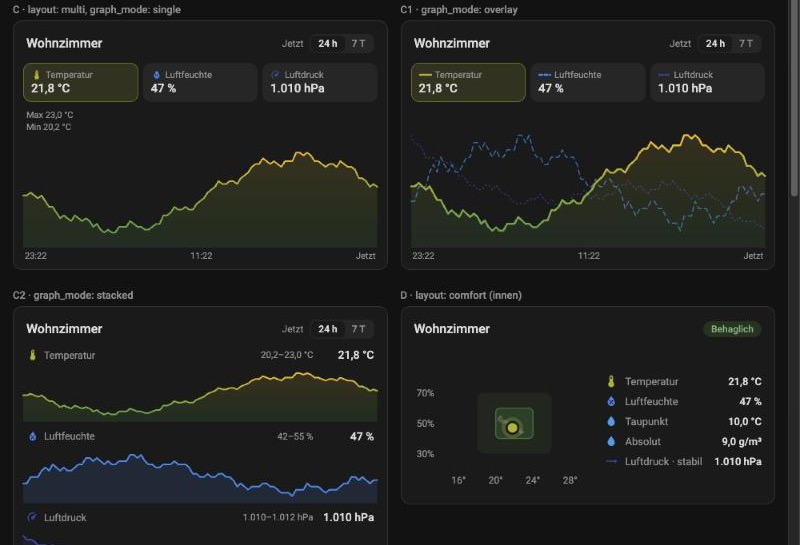

# Climate Sensor Card

Eine Home-Assistant-Karte für Klimasensoren. Sie fasst Temperatur, Luftfeuchte und Luftdruck eines Sensors in einer Karte zusammen, zeigt den Verlauf und bewertet das Raumklima. Die Karte nutzt die Theme-Variablen, Farbnamen und Icons von Home Assistant und passt sich dadurch jedem Theme an.



## Layouts

| Layout | `layout` | `graph_mode` | Inhalt |
| --- | --- | --- | --- |
| Mehrfachverlauf | `multi` | `single` | Messwerte als Schalter, ein Graph für den gewählten Wert |
| Überlagert | `multi` | `overlay` | Alle Verläufe in einem Graphen, unterschieden durch Linienart |
| Getrennt | `multi` | `stacked` | Ein eigener Graph pro Messwert mit Min–Max-Spanne |
| Raumklima | `comfort` | – | Behaglichkeitsfeld mit Spur der letzten Stunden, Taupunkt, absolute Feuchte, Luftdruck-Tendenz |

Mit Maus oder Finger über einen Graphen fahren zeigt die Werte zu diesem Zeitpunkt. Der Umschalter oben rechts wechselt zwischen kurzem Zeitraum (Verlauf, Standard 24 h) und langem Zeitraum (Langzeitstatistik, Standard 7 Tage).

## Farbprofile

- **`indoor`** (Standard): Temperaturfarben von Blau (14 °C) über Grün (20 °C) bis Rot (28 °C). Warnungen bei zu trockener Luft, erhöhter Luftfeuchte und Schimmelgefahr.
- **`outdoor`**: Temperaturfarben von Violett (−15 °C) über Blau (0 °C) und Grün (18 °C) bis Rot (34 °C). Keine Luftfeuchte-Warnungen, dafür Warnungen bei Bodenfrost, Glätte und Hitze. Das Raumklima-Layout zeigt statt Behaglichkeit die Wetterlage und markiert den Glättebereich.

## Installation

### HACS

[](https://my.home-assistant.io/redirect/hacs_repository/?owner=Tronsy&repository=ha-climate-cards&category=plugin)

Oder von Hand:

1. HACS → Menü oben rechts → *Benutzerdefinierte Repositories*
2. `https://github.com/Tronsy/ha-climate-cards` eintragen, Typ *Dashboard*
3. *Climate Sensor Card* installieren und den Browser neu laden (HACS legt die Dashboard-Ressource automatisch an)

### Manuell

1. `climate-sensor-card.js` aus dem neuesten Release nach `config/www/` kopieren
2. Einstellungen → Dashboards → Menü → *Ressourcen* → `/local/climate-sensor-card.js` als *JavaScript-Modul* hinzufügen

## Konfiguration

Die Karte hat einen visuellen Editor. Wählst du dort ein Gerät, findet sie Temperatur, Luftfeuchte und Luftdruck über die `device_class` selbst. Diagnose-Entitäten wie die Chiptemperatur von Zigbee-Sensoren werden dabei übergangen.

```yaml
type: custom:climate-sensor-card
device: 8c1e0f3b9a…              # optional, Sensoren werden automatisch erkannt
name: Wohnzimmer
layout: multi                    # multi | comfort
graph_mode: overlay              # single | overlay | stacked (nur bei multi)
profile: indoor                  # indoor | outdoor
entities:                        # optional, überschreibt die Erkennung
  temperature: sensor.wohnzimmer_temperatur
  humidity: sensor.wohnzimmer_luftfeuchtigkeit
  pressure: sensor.wohnzimmer_luftdruck
```

### Alle Optionen

| Option | Standard | Beschreibung |
| --- | --- | --- |
| `device` | – | Geräte-ID; Sensoren werden automatisch erkannt |
| `entities.temperature` | – | Pflicht, wenn kein `device` gesetzt ist |
| `entities.humidity` | – | optional |
| `entities.pressure` | – | optional |
| `name` | Gerätename | Titel der Karte |
| `layout` | `multi` | `multi` oder `comfort` |
| `graph_mode` | `single` | `single`, `overlay` oder `stacked` |
| `profile` | `indoor` | `indoor` oder `outdoor` |
| `hours` | `24` | Kurzer Zeitraum in Stunden (1–168) |
| `days` | `7` | Langer Zeitraum in Tagen (2–31) |
| `default_metric` | `temperature` | Messwert, der beim Laden ausgewählt ist |
| `show.humidity` | `true` | Luftfeuchte anzeigen |
| `show.pressure` | `true` | Luftdruck anzeigen |
| `show.dew_point` | `true` | Taupunkt anzeigen (Raumklima) |
| `show.absolute_humidity` | `true` | Absolute Feuchte anzeigen (Raumklima) |
| `show.graph` | `true` | Verlauf bzw. Spur anzeigen |
| `show.range_selector` | `true` | Umschalter kurzer/langer Zeitraum |
| `temperature_colors` | Profil | `false` schaltet den Farbverlauf ab, eine Liste setzt eigene Stufen |
| `tint_background` | `false` | Kartenhintergrund leicht nach Temperatur tönen |
| `humidity_thresholds.low` | `30` | Darunter: zu trocken |
| `humidity_thresholds.high` | `60` | Ab hier: erhöht |
| `humidity_thresholds.critical` | `70` | Ab hier: Schimmelgefahr |
| `comfort.temp_min` / `temp_max` | `20` / `24` | Behaglicher Temperaturbereich in °C |
| `comfort.humidity_min` / `humidity_max` | `40` / `60` | Idealer Feuchtebereich in % |

### Eigene Farbstufen

Farben dürfen HA-Farbnamen (`blue`, `light-blue`, `green`, `amber`, `orange`, `red`, `deep-purple` …) oder beliebige CSS-Farben sein. Werte sind immer in °C, auch wenn der Sensor in °F misst.

```yaml
temperature_colors:
  - { value: 16, color: blue }
  - { value: 21, color: green }
  - { value: 26, color: red }
```

## Datenquellen

- Kurzer Zeitraum: Verlauf (`history/history_during_period`)
- Langer Zeitraum: Langzeitstatistik (`recorder/statistics_during_period`, stündliche Mittelwerte). Dafür braucht der Sensor `state_class: measurement`. Fehlt die Statistik, nutzt die Karte den Verlauf.
- Taupunkt und absolute Feuchte werden aus Temperatur und Luftfeuchte berechnet (Magnus-Formel).
- Die Luftdruck-Tendenz vergleicht den aktuellen Wert mit dem Wert vor 3 Stunden: ab ±1 hPa steigt bzw. fällt er, sonst gilt er als stabil.

## Entwicklung

```bash
npm install
npm run dev      # Demo mit simulierten Sensoren: http://localhost:5173/demo/index.html
npm test         # Unit-Tests
npm run build    # dist/climate-sensor-card.js
npm run watch    # baut bei jeder Änderung neu, z. B. direkt nach config/www
```

Ein neues Release auf GitHub baut die Karte und hängt `climate-sensor-card.js` automatisch an das Release an.
